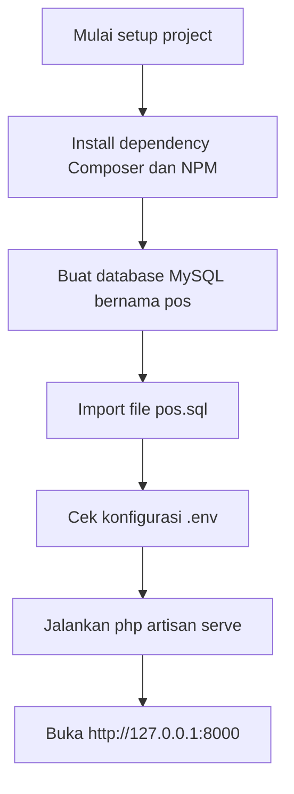
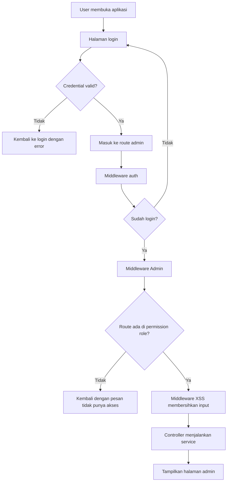
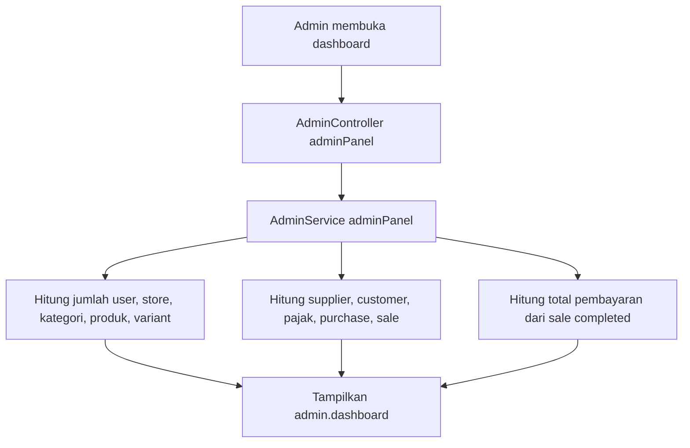
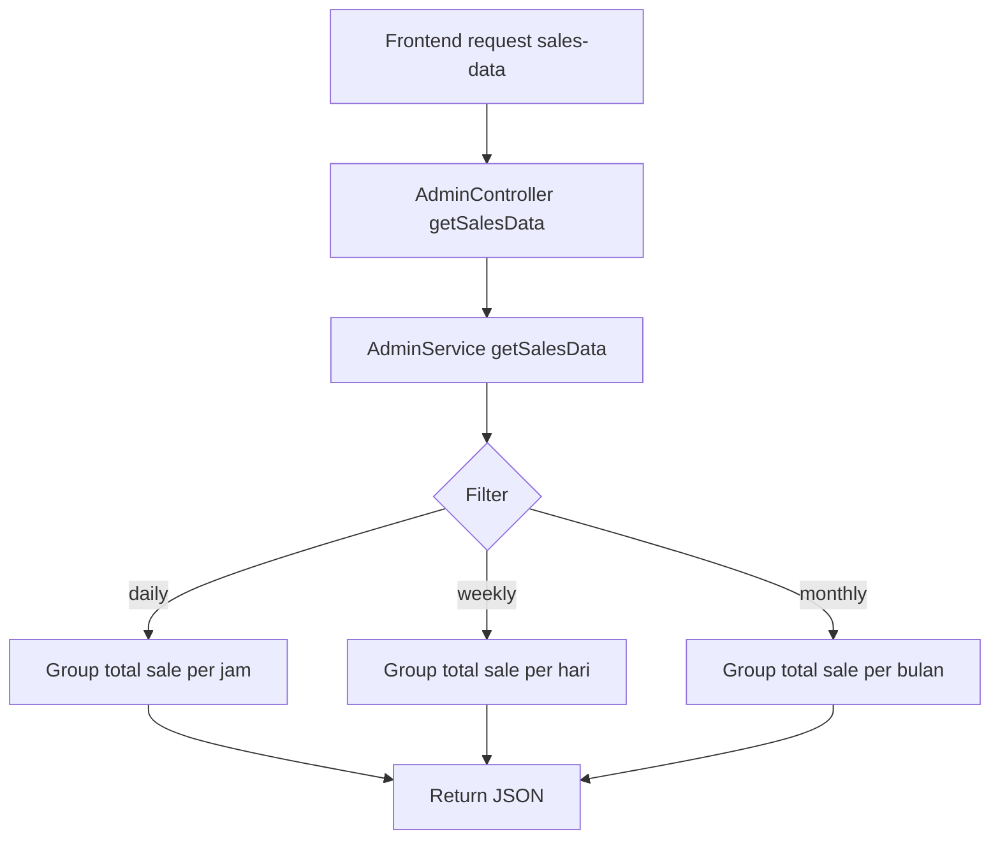
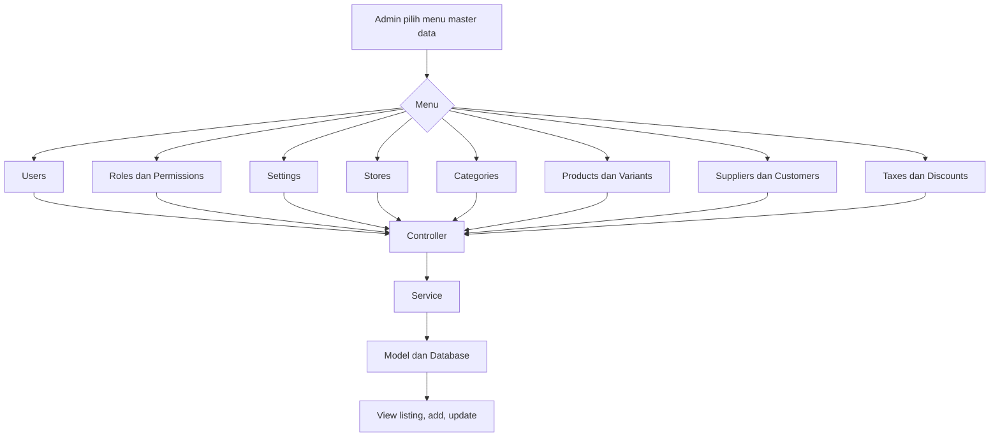
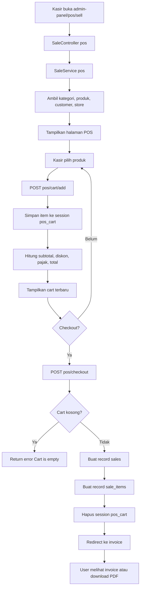
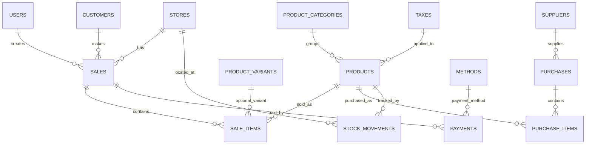

# Flowchart Sistem Point Of Sale

Dokumen ini menjelaskan alur utama aplikasi Point Of Sale berbasis Laravel. File konfigurasi lokal ada di `.env`, dan dump database yang disediakan bernama `pos.sql` dengan database `pos`.

## 1. Setup Lokal



Catatan `.env`:

- `DB_CONNECTION=mysql`
- `DB_DATABASE=pos`
- `DB_USERNAME=root`
- `DB_PASSWORD=` kosong untuk setup XAMPP default
- Jika password MySQL Anda berbeda, ubah `DB_PASSWORD`.

## 2. Alur Login dan Akses Admin



File terkait:

- `routes/web.php`
- `app/Http/Middleware/AdminMiddleware.php`
- `app/Http/Middleware/XssMiddleware.php`
- `app/Http/Controllers/Admin/AdminController.php`

## 3. Alur Dashboard



Data grafik penjualan:



## 4. Alur Master Data

Master data memakai pola yang mirip: route masuk ke controller, controller memanggil service, service membaca atau menyimpan model, lalu kembali ke view.



Operasi umum:

- Listing data: `GET admin-panel/.../listing`
- Form tambah: `GET admin-panel/.../add`
- Simpan data: `POST admin-panel/.../add`
- Form edit: `GET admin-panel/.../edit/{id}`
- Update data: `POST admin-panel/.../update/{id}`
- Hapus data: `GET admin-panel/.../delete/{id}`

## 5. Alur Transaksi POS



File terkait:

- `app/Http/Controllers/POS/SaleController.php`
- `app/Services/Pos/SaleService.php`
- `resources/views/admin/pos/sale/pos.blade.php`
- `resources/views/admin/pos/sale/invoice.blade.php`
- `resources/views/admin/pos/sale/invoice_pdf.blade.php`

## 6. Relasi Data Utama



## 7. Ringkasan Modul

| Modul | Fungsi |
| --- | --- |
| Auth | Login, register, reset password, profile |
| Admin Dashboard | Statistik data dan grafik penjualan |
| Role & Permission | Membatasi akses route berdasarkan role user |
| Product | Kelola produk, kategori, variant, tax, import, export, recycle |
| Store | Kelola toko atau cabang |
| Supplier & Purchase | Kelola pemasok dan pembelian barang |
| Customer | Kelola pelanggan |
| Stock | Kelola pergerakan stok |
| Discount | Kelola diskon |
| POS Sale | Penjualan kasir, cart session, checkout, invoice, PDF |
| Payment | Kelola metode dan pembayaran |

## 8. Urutan Menjalankan Project

```bash
composer install
npm install
php artisan key:generate
php artisan config:clear
php artisan cache:clear
php artisan serve
```

Jika menggunakan file `.env` yang sudah dibuat di project ini, `php artisan key:generate` tidak wajib karena `APP_KEY` sudah terisi. Tetap boleh dijalankan jika ingin membuat key baru.
